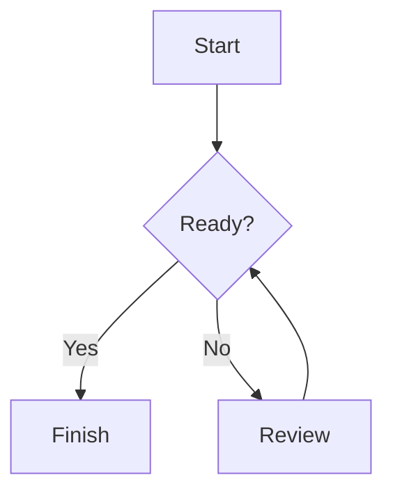

# Flowcharts

Choose **⋯ → Flowchart** in a note or task to insert a starter diagram. In Text view, the diagram opens with a source editor; changes autosave and redraw after a short pause. Use **Edit diagram** to reopen that editor, **Done editing** to close it, or **Delete diagram** to remove the chart.

In Markdown or Split view, write a fenced `mermaid` block:

````markdown

````

Text and Split views render the chart. The original Mermaid source stays in the note, including when surrounding formatted text is edited, the notebook is saved, or Markdown is exported. Invalid syntax displays an error and keeps the source available for correction.

Mermaid **12.3.0** is bundled with the application under its MIT license. Rendering works offline; Node.js, npm, and a CDN connection are not required. Diagram colors follow the app theme, and charts fit the available editor width.

The integration uses Mermaid's strict rendering mode, with HTML labels and click callbacks disabled. Each chart allows up to 50,000 source characters and 500 edges. Flowcharts are covered by the application's tests; other Mermaid diagram types are not guaranteed by this integration.

See the [Mermaid flowchart syntax](https://mermaid.js.org/syntax/flowchart.html) and the [bundled library notice](../src/main/resources/dev/gorgi/notes/editor/mermaid/NOTICE.md).
